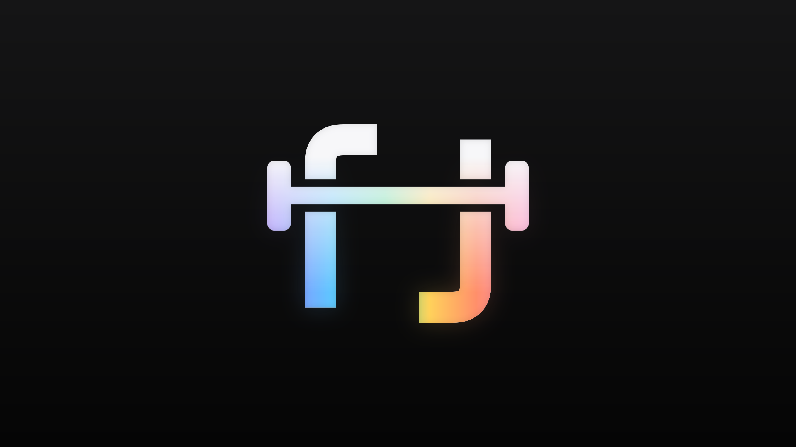

# Rerack

A workout tracker I built to replace the notes app I was logging my lifts in. It runs on the web, as a home-screen app, and as an iPhone app on TestFlight.

## What it does

- **Plan**: build workouts and group them into routines, with optional days of the week. Paste a plan from your notes and it turns it into workouts, asking about anything it can't work out.
- **Log**: check in and fill in sets as you go. Last time's numbers show in each set, so you know what to beat. Checking off a set starts a rest timer.
- **Track**: a training heatmap, a week-over-week summary, and progress charts for each exercise and workout (estimated 1RM, or total reps for bodyweight moves).
- **Look back**: a notes-style log of each exercise's last day, and a full history of every workout.

## On the iPhone

- The live workout sits on the lock screen and in the Dynamic Island: the current exercise and set, and the rest countdown.
- A notification when your rest is over, haptics, and finished workouts saved to Apple Health.
- Swipe between tabs, press and hold for menus, and drag to reorder.

## How it's built

- **React 19, TypeScript and Vite**, with the domain logic (stats, progression, supersets, import parsing) kept in plain TypeScript, separate from the UI.
- **Firebase** sign-in (Apple or Google) and Firestore sync that works offline, or no account at all, with everything kept on the device in IndexedDB.
- **Capacitor** for the iPhone app, with Swift for the Live Activity, haptics and HealthKit.
- An installable **PWA** that opens with no signal.
